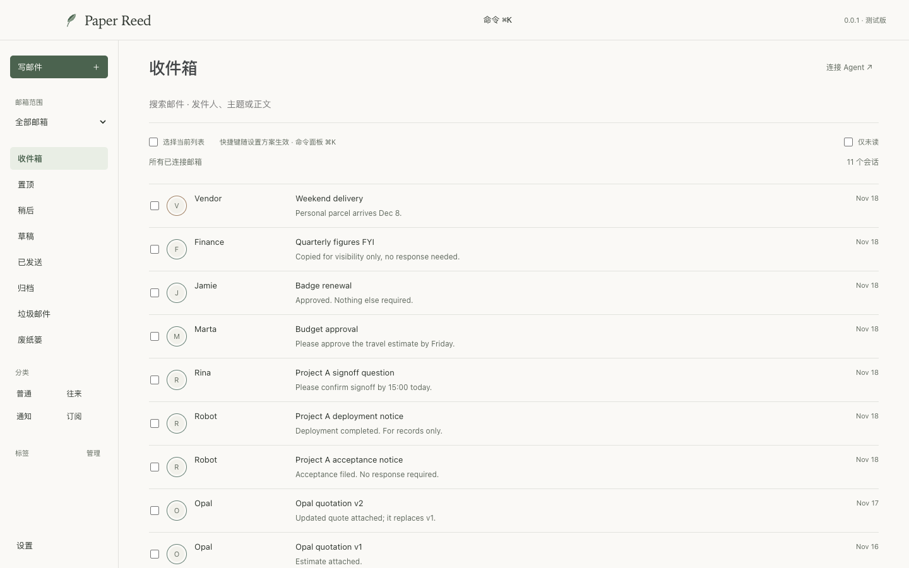

  

<h1 align="center">Paper Reed</h1>

<strong>A quieter email client for Mac.</strong>

  An open-source inbox for reading and writing mail, with a CLI for the agents you already use.

  <a href="https://github.com/macopc/PaperReed/releases/download/v0.0.2/Paper-Reed-0.0.2-macOS-arm64.zip"><strong>Download 0.0.2 for Apple Silicon</strong></a>
  · <a href="https://github.com/macopc/PaperReed/releases/tag/v0.0.2">Release notes and checksum</a>
  · <a href="README.md">中文</a>

*Desktop screenshot from a test build using synthetic mail.*

## Everyday mail

- **One inbox for work and personal mail.** Account colors show where each message came from. Connect Gmail, iCloud, or an account with IMAP and SMTP.
- **Find mail as you type.** Instant search can match fragments of Chinese text. Move between conversations with the keyboard or open the command palette with `⌘K`.
- **Keep track of what matters.** Pin important threads, snooze the ones that can wait, and organize the rest with custom labels and local rules.
- **Read and reply in the same place.** Stay in the desktop app to read threads, compose replies, and handle attachments. Drafts are saved locally.

## Let an agent draft. Review on your Mac.

Open **Settings → Agent Connection** (设置 → Agent 连接), enable the local connection, and install `paper-reed`. Choose which mailboxes and actions the agent can access, then paste the setup instructions into a local Claude Code, Codex, or OpenCode session that can run shell commands.

> Find the supplier’s latest reply about the delivery date, draft a confirmation, and leave it in Drafts for me to review.

An agent can search mail, read the conversation, and leave a draft you can open and edit in the app. Sending is a separate action with its own permission. You can also limit access to reading or to reading and drafting. [CLI guide](research/cli/README.md) · [Draft handoff and send recovery tests](research/agent-receipts-2026-11-18/README.md)

## Install the preview

Download and unzip the archive, then drag `Paper Reed.app` into Applications. Version `0.0.2` is a signed, notarized preview for Apple Silicon Macs. Updates are installed manually from GitHub Releases. Provider compatibility is still being tested. Generic accounts require IMAP and SMTP access. [Download, release notes, and checksum](https://github.com/macopc/PaperReed/releases/tag/v0.0.2)

## Get involved

Paper Reed runs on your Mac and connects directly to your mail provider. There’s no Paper Reed server to deploy. The desktop app is built from pinned Mailspring and Mailspring-Sync sources, with Paper Reed’s changes maintained as patches. [Source and patches](research/patches/README.md) · [Research and test records](research/README.md)

Tell us where a real email workflow gets awkward, report a UI issue, or contribute a focused improvement. For bug reports, include your version, steps to reproduce, and screenshots with private information removed. [Open an issue](https://github.com/macopc/PaperReed/issues/new/choose) · [Contributing](CONTRIBUTING.md) · [Roadmap](ROADMAP.md)

To explore the design, clone the repository and open the [interactive prototype](design/direction.html) in a browser. It uses sample mail and runs without a server. [Prototype pages](design/PAGES.md) · [Interface notes](design/INTERFACE.md)

Original repository content is licensed under [GPL-3.0-only](LICENSE). Upstream code and assets retain their respective licenses. [Third-party notices](THIRD_PARTY_NOTICES.md)
