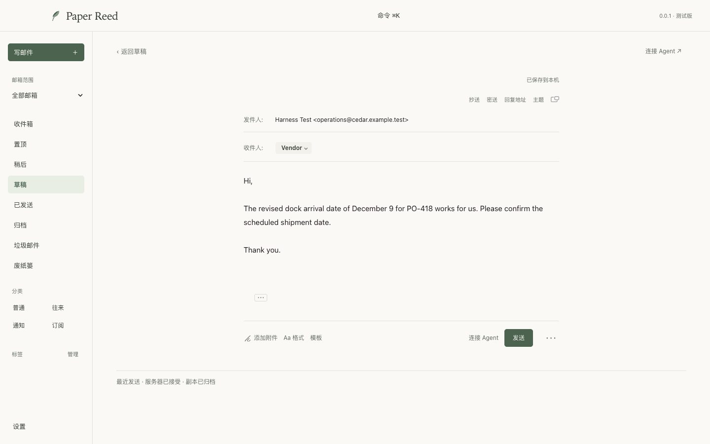
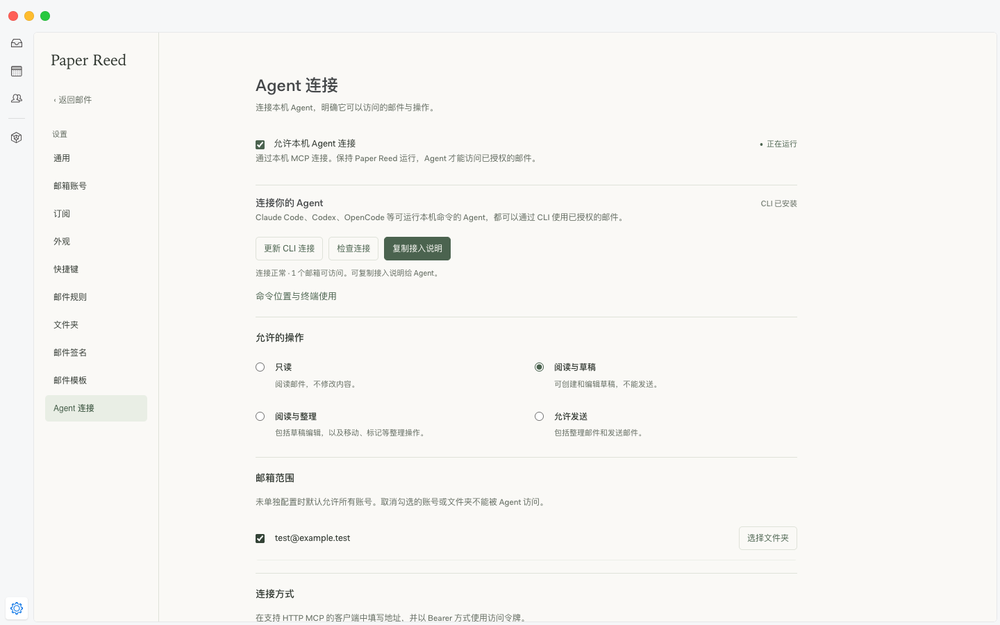

  

<h1 align="center">Paper Reed</h1>

<strong>The open-source Mac email client for AI agents.</strong>

  Give Claude Code, Codex, or OpenCode a local CLI to find mail, organize your inbox, and draft replies. Open the same draft in Paper Reed to review it.

  <a href="https://github.com/macopc/PaperReed/releases/download/v0.0.2/Paper-Reed-0.0.2-macOS-arm64.zip"><strong>Download 0.0.2 for Apple Silicon</strong></a>
  · <a href="https://github.com/macopc/PaperReed/releases/tag/v0.0.2">Release notes and checksum</a>
  · <a href="README.md">中文</a>

*Codex drafted this reply for review in Paper Reed. The screenshots on this page show running development builds with synthetic mail.*

## Start with a task

> Reply to the supplier who updated the delivery date for PO-418 in my work inbox. Tell them the new date works and ask them to confirm when they’ll ship. Leave the draft for me to review.

In the test, Codex used `paper-reed` to find the thread and save a reply draft with the original message quoted. The CLI returned a save receipt, and the same draft opened in the desktop app. [Eight agent workflows and test results](research/agent-receipts-2026-11-18/README.md)

## Connect your agent

Open **Settings → Agent Connection** (设置 → Agent 连接), enable the local connection, and install `paper-reed`. Choose which mailboxes and actions to grant, then copy the setup instructions into an agent session that can run local shell commands. Keep Paper Reed open while the agent works.

Access can be limited to reading, drafting, or organizing. Sending requires enabling send permission. [CLI guide](research/cli/README.md)

| What your agent can access | Your inbox on Mac |
| --- | --- |
|  |  |

Connect Gmail, iCloud, or a generic IMAP/SMTP account. Search across your unified inbox as you type, open the command palette with `⌘K`, and organize threads with pins, snooze, labels, and local rules.

## Install the preview

Download and unzip the archive, then drag `Paper Reed.app` into Applications. Version `0.0.2` is a signed, notarized preview for Apple Silicon Macs. Updates are installed manually from GitHub Releases. Provider compatibility is still being tested. Generic accounts require IMAP and SMTP access. [Download, release notes, and checksum](https://github.com/macopc/PaperReed/releases/tag/v0.0.2)

## Get involved

Paper Reed runs on your Mac and connects directly to your mail provider. There’s no Paper Reed server to deploy. The desktop app is built from pinned Mailspring and Mailspring-Sync sources, with Paper Reed’s changes maintained as patches. [Source and patches](research/patches/README.md) · [Research and test records](research/README.md)

Tell us where a real email workflow gets awkward, report a UI issue, or contribute a focused improvement. For bug reports, include your version, steps to reproduce, and screenshots with private information removed. [Open an issue](https://github.com/macopc/PaperReed/issues/new/choose) · [Contributing](CONTRIBUTING.md) · [Roadmap](ROADMAP.md)

To explore the design, clone the repository and open the [interactive prototype](design/direction.html) in a browser. It uses sample mail and runs without a server. [Prototype pages](design/PAGES.md) · [Interface notes](design/INTERFACE.md)

Original repository content is licensed under [GPL-3.0-only](LICENSE). Upstream code and assets retain their respective licenses. [Third-party notices](THIRD_PARTY_NOTICES.md)
