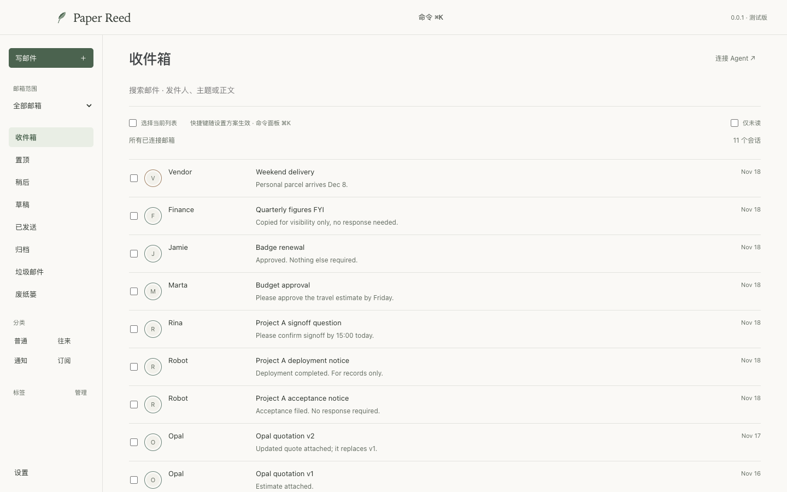

  

<h1 align="center">Paper Reed</h1>

<strong>安静一点的 Mac 邮件客户端。</strong>

  一个开源收件箱，用来认真读信、写信，也能让你常用的 Agent 搭把手。

  <a href="https://github.com/macopc/PaperReed/releases/download/v0.0.2/Paper-Reed-0.0.2-macOS-arm64.zip"><strong>下载 0.0.2 · Apple Silicon</strong></a>
  · <a href="https://github.com/macopc/PaperReed/releases/tag/v0.0.2">版本说明与校验值</a>
  · <a href="README.en.md">English</a>

*桌面客户端实拍。截图来自功能验证构建，邮件为合成测试数据。*

## 日常读写

- **一个收件箱，多种邮箱。** 把工作和个人邮件放在一起，用颜色认出来自哪个账号。支持 Gmail、iCloud 和通用 IMAP／SMTP 配置。
- **边输入，边找信。** 即时搜索支持中文片段。用键盘在会话之间移动，或按 `⌘K` 打开命令面板。
- **按自己的方式整理。** 把重要会话置顶，将暂时不处理的邮件设为稍后，或用自定义标签和本机规则归类。
- **在同一个地方读信和回信。** 阅读会话、起草回复和处理附件都在桌面端完成，草稿会保存在本机。

## 让 Agent 起草，回到桌面审阅

在 **设置 → Agent 连接** 开启本机连接并安装 `paper-reed`。为 Agent 选择可访问的邮箱和允许的操作，然后把接入说明贴给能执行本机命令的 Claude Code、Codex 或 OpenCode。

> 找到供应商对交期的最新回复，起草一封确认邮件，留在草稿箱给我检查。

Agent 可以搜索邮件、读取会话并创建草稿。CLI 和桌面共用草稿，打开同一份就能继续编辑。发送是单独操作，需要启用发送权限；也可以只授予阅读或「阅读与草稿」权限。[CLI 使用说明](research/cli/README.md) · [草稿交接与发送恢复实测](research/agent-receipts-2026-11-18/README.md)

## 安装测试版

下载 ZIP，解压后把 `Paper Reed.app` 拖进「应用程序」。`0.0.2` 是面向 Apple Silicon Mac 的已签名、公证测试版，当前通过 GitHub Releases 手动更新。邮箱兼容性仍在验证，通用账号需要服务商开放 IMAP／SMTP。[安装包、版本说明与校验值](https://github.com/macopc/PaperReed/releases/tag/v0.0.2)

## 在这里参与

Paper Reed 在本机运行，直接与邮箱服务商连接，无需部署 Paper Reed 服务端。桌面端基于固定版本的 Mailspring 和 Mailspring-Sync 构建，改动以补丁维护。[源码与补丁](research/patches/README.md) · [研究与验证记录](research/README.md)

欢迎提交具体的邮件操作场景、界面问题或小型改进。报告问题时请附上版本、复现步骤与脱敏截图。[提交 Issue](https://github.com/macopc/PaperReed/issues/new/choose) · [贡献指南](CONTRIBUTING.md) · [路线图](ROADMAP.md)

想看设计过程，可以把仓库克隆到本地，用浏览器打开 [交互原型](design/direction.html)。原型使用示例数据，无需启动服务。[页面目录](design/PAGES.md) · [界面设计](design/INTERFACE.md)

本仓库原创内容以 [GPL-3.0-only](LICENSE) 发布。上游代码与素材沿用各自许可。[第三方来源与许可](THIRD_PARTY_NOTICES.md)
