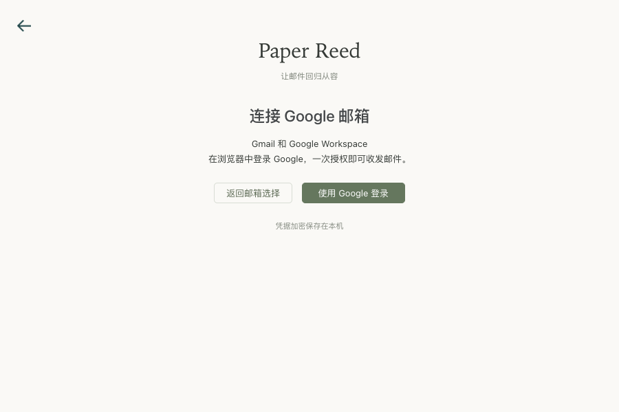

# Gmail 统一登录与重连

2026-11-17。此前 `9b07c91` 已推送；本轮先完成 Gmail 统一 OAuth，并提供 [Microsoft 应用注册填写清单](../provider-integration-2026-11-17/MICROSOFT-SETUP.md)。不新增服务端、provider 框架、token 存储或任务队列。

## 行为变化

- Gmail / Google Workspace 入口只需点击“使用 Google 登录”。维护者一次配置自己的 Google Desktop client JSON，用户无需逐个邮箱选文件，也不再输入应用专用密码。
- 使用 `openid email https://mail.google.com/`。完整邮件 scope 是现有 IMAP 引擎使用 XOAUTH2 所必需的，也覆盖 Gmail HTTPS 发信；不能把只有 `gmail.send` 的旧 grant 当成 IMAP 凭据。[Google 协议说明](https://developers.google.com/workspace/gmail/imap/xoauth2-protocol)。
- 只持久化一个通用 `refresh_token`，沿用 KeyManager 加密。原生 IMAP 与 HTTPS 发信共用现有 XOAuth2TokenManager 的刷新、过期缓存和刷新令牌更新通知；项目 client ID / secret 来自维护者配置，不使用 Mailspring 的身份。
- 旧“应用密码收信 + 独立 send-only grant 发信”账号继续可用。主动重连并通过连接检查后，保留原 ID、名称、颜色和邮件／草稿引用，更新账号 provider 并替换旧密码和发信 grant。取消、选错账号、缺少权限或连接失败不会覆盖旧账号。
- 离开登录页会取消等待中的授权；即使已经进入原生连接检查，迟到的结果也不能保存账号。刷新服务的 503 / 429 或网络中断进入已有连接恢复流程；明确撤销授权才需要重连。最终发送仍不自动重试、不回退 SMTP。

改动分为 [0036 原生补丁](../patches/0036-gmail-shared-oauth.patch) 与 [0037 桌面补丁](../patches/0037-google-login-reconnect.patch)。Google 页面复用已有 Paper Reed 字体、间距和按钮样式。

## 维护者配置

用项目自己的 **Google OAuth Desktop app** JSON。开发启动：

```sh
PAPER_REED_GOOGLE_CLIENT_FILE='/绝对路径/Google-Desktop-client.json' \
  python3 scripts/start-desktop.py
```

同一变量可传给 `node app/build/build.js --skip-installers`，构建器仅把 `installed.client_id`、`installed.client_secret` 写到应用资源内的 `paper-reed-google-client.json`。打包后不要求用户设置环境变量。桌面 OAuth client 的配置会随客户端发行，它不应被当作服务端保密凭据；用户 refresh token 不进入应用包或源码。

Google Cloud 应开启 Gmail API，并在 Data Access 中包含 `https://mail.google.com/` 及身份 scope。项目仍在 Testing 时，需要将真实测试邮箱列为测试用户。已经配置的 send-only 授权不会自动获得新权限，必须由用户重新同意。缺少项目配置的构建会显示明确错误，不会选择第三方 OAuth 身份。

## 验证

所有自动邮件发送均在 loopback fixture 内，未对真实邮箱发送邮件，也未更改代理配置。

| 检查 | 结果与边界 |
| --- | --- |
| Google 授权模块 | 10 项：新账号、指定邮箱、项目配置缺失、拒绝授权、账号不符、缺少完整邮件权限、仅发信权限、缺少 refresh token、交换失败、取消。执行生产模块和实际本机 HTTP callback；PKCE / state 校验通过。 |
| 账号构建及其他服务商授权 | [16 项通过](onboarding-results.json)：包含 Gmail 重连保留身份、离开页面后不保存，以及原 Microsoft / iCloud / IMAP 配置回归。 |
| 实际原生引擎 | [12 项 Gmail 检查通过](gmail-results.json)：8 项旧凭据路径，4 项统一 OAuth；统一授权实际执行无密码 IMAP 认证和 HTTPS 发信，共用一次缓存刷新，重启和重复提交无重复发送，503 与撤销授权分类正确。 |
| Microsoft 原生回归 | [5 项通过](microsoft-regression.json)：接受、拒绝、503、响应丢失、刷新拒绝；无 SMTP 回退。 |
| Electron 开发版 | 实际 Google 页面、无密码／文件选择器、缺少配置提示；普通 IMAP 首次连接、失败不保存、重连、CLI、写信、发送与归档通过。额外执行真实 AccountStore / KeyManager 的 provider 更新和加密凭据回读。 |
| macOS 应用包 | 重建 `.app` 并重复上述完整首用流程通过，fixture SMTP 恰好一封；[结果](packaged-ui-result.json)。构建未内置真实 Google client，因此 Google UI 验证的是入口和未配置提示；真实授权仍待完成。 |
| 构建与补丁 | 原生 Release 构建、完整 TypeScript 检查通过；37 个补丁从固定版本重放成功，109 个源码文件与测试 checkout 一致。 |



复现入口：

```sh
node research/harness/check-google-authorization.cjs research/.local/Mailspring
node research/harness/check-provider-onboarding.cjs research/.local/Mailspring
sandbox-exec -f research/harness/loopback-only.sb \
  research/.local/venv/bin/python research/harness/check-gmail-api.py \
  --upstream research/.local/Mailspring \
  --binary research/.local/derived-data/Build/Products/Release/mailsync \
  --output research/.local/gmail-oauth-validation
```

## 尚未完成

真实 Gmail 统一授权尚需用户重新同意完整邮件 scope。此前真实 Gmail HTTPS 测试验证的是旧 send-only 路径，不能作为本轮统一登录的真实服务商证明。现有真实 profile 未迁移、旧草稿和发送记录未改写。

Google restricted-scope 应用验证、Microsoft 应用注册／真实授权，以及 macOS 正式签名、公证和发行配置仍待完成。Google 对完整邮件 scope 有审核要求；代码支持不等于公众发布已获批准。[scope 与验证说明](https://developers.google.com/workspace/gmail/api/auth/scopes)。
