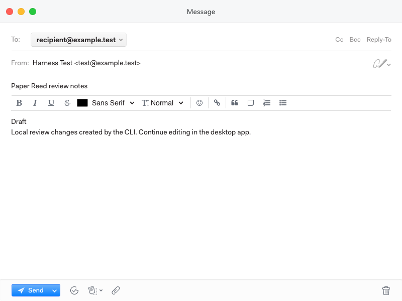
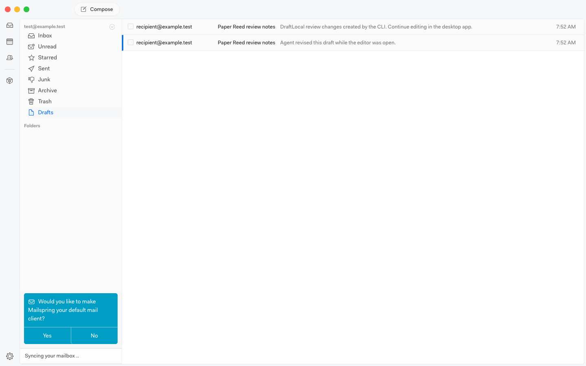
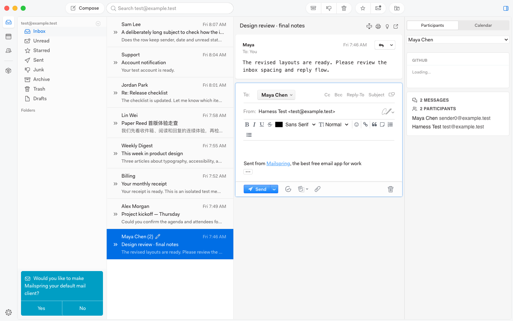
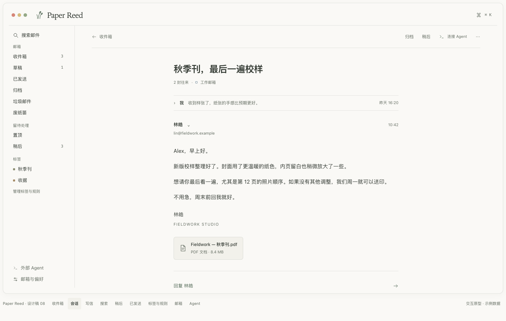
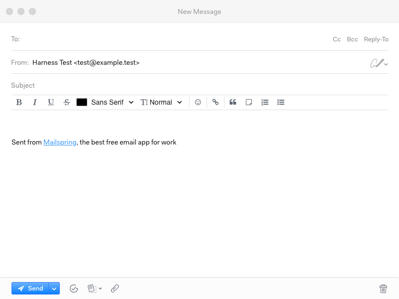
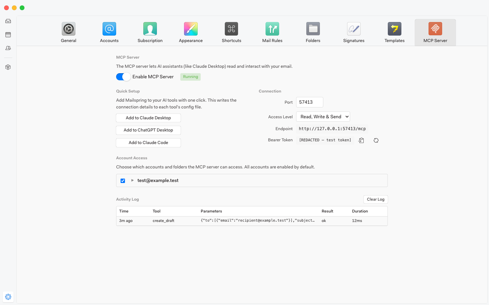
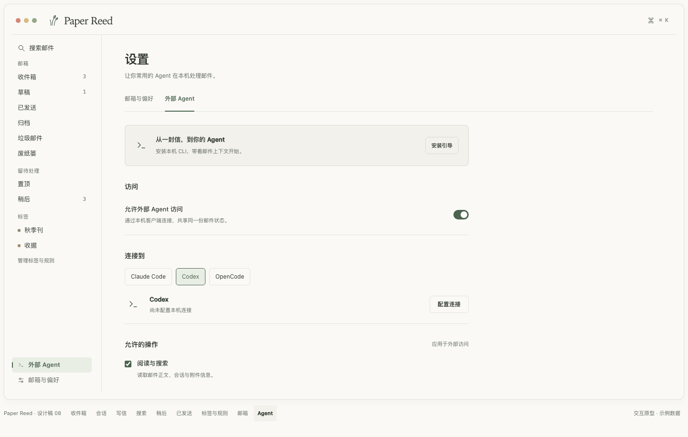
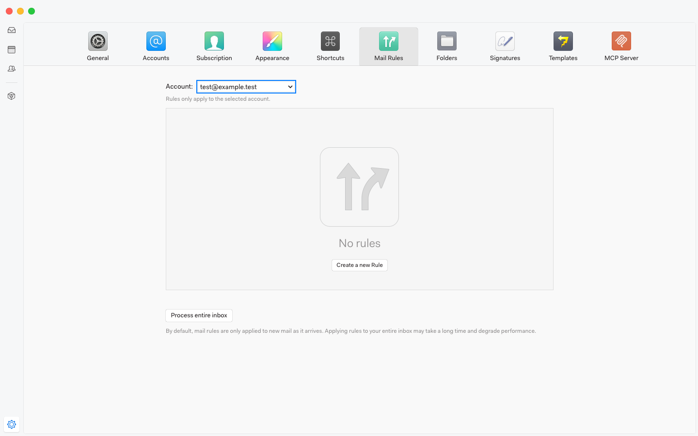
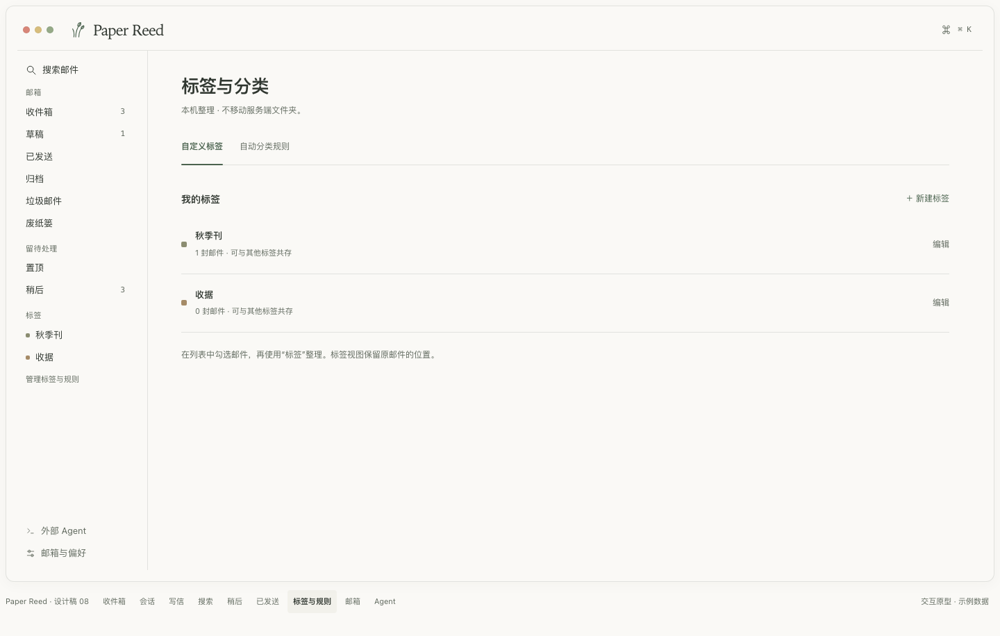

# Paper Reed：运行界面与设计／spec 的体验差距

2026-11-16。原则：用户应从页面结构、状态和操作入口理解当前对象与下一步，不必理解邮件引擎、MCP 或修订号。结论：共享核心已能工作，但当前运行界面仍是上游产品。最大的工作是把已验证能力接成连续的用户任务，而不是继续增加零散功能或只换皮肤。

## 范围与证据

对照 [界面规格](../../design/INTERFACE.md)、[首版邮件核心](../../design/MAIL-CORE.md) 和 [Agent 交接设计](../../design/AGENT-HANDOFF.md)。运行固定 Mailspring 桌面源码及 0001–0006 实验补丁，使用隔离配置、一个本机 IMAP/SMTP 测试账号、8 封测试邮件及 CLI 草稿；没有接入真实邮箱，没有发送邮件，也没有修改真实 Agent 配置。

实机覆盖：收件箱、选择阅读、内嵌回复、新建写信窗口、草稿列表及打开 CLI 草稿、一般设置、MCP 设置、规则页、草稿冲突后的编辑区。设计图由现有 HTML 渲染，并未重新设计。设计预览只在临时副本中把视口高度固定为 900px；实机主窗口 1440×900，弹出写信窗口 800×600。不同测试文案不能用来推断阅读速度或像素级还原率。

桌面控制工具无法连接实验 Electron，改用现有 Playwright/CDP 测试通道。主要页面通过鼠标操作；偏好设置使用其真实 `Actions.openPreferences` 入口，因为系统菜单不在 renderer 截图范围。MCP 页面只查看，令牌在截图前明确遮盖。冲突提示通过适配器记录并确认，截图展示确认提示后的编辑区，**没有验收原生对话框的视觉效果**。

本轮没有产品代码修改；只增加审查启动方式、证据和本报告。已有副本恢复补丁仍是上一轮的待提交内容。

## 1. P0：保存、冲突和恢复有底层结果，缺少持续可见的用户状态

任务：编辑 CLI 创建的草稿，同时外部工具更新它；用户需要知道哪些内容已保存、现在该怎么做。



事实：普通写信窗口没有设计稿顶部的草稿保存状态。触发冲突并确认提示后，编辑区继续看起来像普通草稿。源码中空闲保存错误直接把 `error.message` 传给提示框，因此会暴露 `draft-conflict` 这样的内部错误；“继续编辑／另存副本并关闭”则放在关闭流程里。副本保持原主题，没有来源标识或创建后定位入口。发送结果虽然可以经 CLI 查询，但目前没有按 spec 设计的统一 `unknown` 核对和副本失败恢复界面。



证据边界：保存／冲突编辑区、继续编辑与另存后的列表是本轮实机观察，提示选择由适配器执行；重启恢复能力参考 [上一轮恢复验证](../recovery-copy-validation.md)；发送异常界面的缺口来自现有代码和 spec 对照，本轮没有重新注入 SMTP 崩溃。

目标设计也有缺口：[写信稿](../../design/pages/compose.html) 只呈现“草稿已保存”，不能直接作为所有真实状态的交付依据。

具体改法：在原有顶部位置统一显示“保存中／已保存到本机／保存失败／已被其他端修改”。冲突时保持输入，直接提供“另存副本”；载入最新稿须先明确处理当前未保存输入。副本创建后提供“打开副本”，在草稿列表用辅助标记说明来源，不改邮件主题。发送的服务器接受、结果待确认和已发送副本失败分别呈现，不用一个成功提示覆盖。

验收任务（待实施）：GUI 输入后由 CLI 更新；不关闭窗口也能识别冲突和另存。另存失败仍保留输入；成功后能直接定位副本，重启后能辨认原稿与副本。发送未知状态不提供含糊的“一键重试发送”。

来源：`app/src/flux/stores/draft-change-set.ts:91`、`draft-store.ts:126`，以及 [0006 补丁](../patches/0006-conflict-recovery-copy.patch)。

## 2. P1：阅读、回复和写信没有形成设计要求的共同结构

任务：从列表扫读一封信，继续回复，或打开草稿写信。





事实：实机主窗口是导航、邮件列表、阅读区、联系人侧栏并排。当前 1440px 窗口下，中间阅读区明显窄于设计的 640px 正文版心。内嵌回复和弹出写信窗口使用不同的空间结构；字号、正文节奏、格式工具和操作位置没有遵循设计基线。列表没有采用已选的账号色环，分类／本机标签也没有对应位置。上游默认签名、默认邮件客户端提示和额外设置仍可见。



这些不是底座本身的质量结论，而是 Paper Reed 尚未完成产品接入的证据。基本邮箱导航已经存在，草稿列表也能打开 CLI 草稿，不能把它描述成“全部页面不可用”。

具体改法：先接三个真实页面——收件箱、会话／回复、写信。保留同一套正文容器、编辑器外框和动作区；联系人信息按需展开，释放正文空间。实现账号色环与未读的独立编码，先保证账号归属，再打磨行距。关闭与产品无关的默认营销签名及提示，保持必要的邮箱身份信息。

验收任务（待实施）：在 1440×900 和 900×700 连续完成列表→阅读→回复→草稿恢复；正文和动作区不跳换职责；长主题不挤掉账号／日期，输入中文和 Cc/Bcc 后切换页面不丢失。窄窗口和第二账号本轮尚未实测。

来源：[INTERFACE.md 的页面结构、密度与节奏、方向 B](../../design/INTERFACE.md)，上游 `message-list` 与 `composer` 界面。这里需要结构接入，不能只改主题色。

## 3. P1：Agent 有连接配置，但缺少当前任务的交接入口

任务：把正在读的邮件、已选邮件或当前草稿交给常用 Agent，并回来继续编辑。





事实：上游已提供运行状态、账号访问范围和 Quick Setup，能看到 Add to Claude Desktop、Add to ChatGPT Desktop、Add to Claude Code。不能说“完全没有一键连接”。但收件箱、阅读、回复、写信动作区没有 Paper Reed 的“连接／交给 Agent”入口；这里也没有 Paper Reed CLI 的安装状态、Codex/OpenCode 的产品交接路径，或明确的当前对象范围。

当前 Running 只能说明本机 MCP 正在监听，不能说明 CLI 已安装、目标 Agent 已连接、当前草稿已保存并完成交接。端口、Endpoint、Bearer Token 与主要操作并排，会把使用流程变成配置流程。截图中的发送访问级别是本实验预设，不是对产品默认授权的判断。

具体改法：复用已有连接能力，增加任务入口和三项独立状态：CLI 是否可用、目标 Agent 是否就绪、当前范围是否可交接。从邮件进入时固定账号和对象；从草稿进入时先保存，冲突则停在当前编辑区。端口／令牌放到高级连接设置。完成安装或配置后回到原任务，不静默扩大到整个收件箱。

验收任务（待实施）：在一封信或一个草稿上发起交接；首次安装回来仍保留对象和任务文字；未授权账号被明确阻止；Agent 产出的草稿能直接打开，用户发送后工具查询到同一结果。

来源：[AGENT-HANDOFF.md](../../design/AGENT-HANDOFF.md)，`app/internal_packages/mcp-server/lib/preferences-mcp.tsx`，现有 [CLI 能力](../cli/README.md)。本轮没有点击会修改真实工具配置的 Quick Setup。

## 4. P1：邮箱位置、本机整理和分类尚未按 spec 分开

任务：将邮件稍后处理、加跨账号标签或按规则分类，同时理解是否会影响服务商邮箱。





事实：当前导航是 Inbox、Unread、Starred、Sent、Junk、Archive、Trash、Drafts、Folders。规则页明确只作用于选定账号。设计与 spec 则要求独立的本机置顶、稍后、自定义标签和分类。源码中上游稍后通过移动文件夹或修改服务端标签实现，不能直接改名当作 spec 中“仅从本机收件箱隐藏”的稍后。

证据边界：本轮审查配置有意禁用了上游稍后等扩展，因此“未显示稍后”不证明上游没有此能力；上述语义差异由 `thread-snooze/lib/snooze-utils.ts:28` 的实现确认。本轮没有执行或验收服务端移动。

具体改法：先接已有邮箱位置导航，明确选择集和操作对象。本机标签、置顶、稍后在真正具备本机语义后再启用；未完成的原型入口不要伪装成可用功能。标签名称／颜色使用同一份本机配置，侧栏色点与邮件标签保持一致。

验收任务（待实施）：在两个账号上加同一本机标签，不改变远端文件夹或标签；稍后到期恢复本机视图，垃圾邮件不被复活；列表勾选后执行归档，目标集合与数量始终明确。

来源：[MAIL-CORE.md §4–5](../../design/MAIL-CORE.md)、[标签与分类设计](../../design/pages/organize.html)。

## 建议下一轮只交付一个可以亲自使用的闭环

优先做单账号、真实引擎数据驱动的 Paper Reed 收件箱→会话／回复→写信，沿用已有核心。把保存、冲突、另存副本、发送结果一并接入；为当前邮件／草稿留出明确 Agent 入口。暂不扩展规则、批量自动化或新的后端抽象。

先补设计里的异常状态，再实施这三个页面。验收时用同一封信和同一草稿连续操作，不再分别用一个漂亮的静态原型和一个正确的后端测试代表完整体验。真实邮箱授权仍需推进，但不妨碍先完成本机测试数据下的界面接线。

## 未覆盖与测试工具限制

未覆盖：真实授权首次使用、多账号辨识及串号、搜索缓存范围、离线／睡眠唤醒、附件全流程、中文输入法组词、键盘与辅助功能完整走查、性能和打包。观察到受网络隔离影响的 GitHub 侧栏 Loading，只能作为离线呈现候选，不能据此认定真实网络环境下始终失败。

最初测试邮件的非 ASCII 标题未做 RFC 2047 编码，已修正 fixture 并重跑；本报告不将该乱码列为产品缺陷。附加 CDP 连接在关闭窗口时触发过 Playwright 的 `No dialog is showing`，是已知 Electron beforeunload 自动响应冲突；审查模式增加旁观监听避免自动回答，不修改产品关闭逻辑。原生菜单和对话框的完整视觉验收仍待补。

## 复现审查环境

已准备固定上游源码、补丁和测试依赖时，在仓库根目录运行：

```sh
sandbox-exec -f research/harness/loopback-only.sb \
  research/.local/venv/bin/python research/harness/check-compose-handoff.py \
  --upstream research/.local/Mailspring --audit
```

终端出现 `AUDIT READY` 后可操作隔离窗口；最多运行 30 分钟。在打印的产物目录创建 `finish-audit` 文件会正常结束审查。它只创建本机 fixture 账号和测试草稿，不接入现有邮箱配置。

本轮页面走查使用 `compose-handoff-7n1zzmsd` 的截图；修正测试工具 beforeunload 监听后，冲突与副本列表在新配置 `compose-handoff-e2jfboaj` 重新观察并成功结束，SMTP 投递数为 0。实验进程已清理。未将中途工具错误当作产品关闭故障，也未宣称整套端到端用例全部重新通过。

[可切换的截图对照](index.html) 可直接在浏览器打开。图中“已有设计稿”均来自现有原型，“实机截图”均来自本轮实验应用；没有用建议图充当实现证据。
